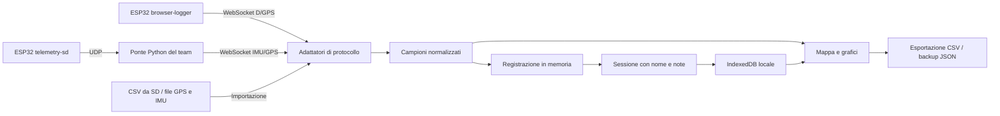

# Architettura e confini

## Obiettivo

SFT Telemetry Lab deve accompagnare una sessione dal sensore allo studio post-uscita. È l'interfaccia del progetto end to end; firmware, acquisizione e bridge sono mantenuti in [sft-telemetry](https://github.com/sapienzafoilingteam/sft-telemetry).

## Implementazione attuale

React/Vite gestiscono l'interfaccia; PapaParse interpreta i file, Leaflet la mappa, Recharts i grafici. Gli adattatori normalizzano campi e unità prima delle metriche. I dati originali restano nei file importati sul computer; l'archivio contiene attualmente solo i campioni normalizzati. Non esiste un servizio di backend in questa repository.

IndexedDB usa il database `sft-telemetry-lab`, versione 1, store `sessions` e chiave `id`. Una sessione contiene `id`, `name`, `source`, `createdAt`, `notes`, `samples`. Ogni browser/origine ha il proprio archivio. Il backup JSON ha `version: 1` e `session`; la reimportazione crea un nuovo ID.

## Limiti da preservare nella comunicazione

- La registrazione live resta in RAM fino al salvataggio. Chiusura/crash possono perdere dati non salvati.
- Non ci sono sincronizzazione team, account, storage remoto o recupero automatico.
- Non ci sono comandi di controllo, calibrazione della scheda o avvio della registrazione SD.
- GPS e IMU importati separatamente creano sessioni distinte. La sincronizzazione richiede un'origine temporale condivisa.
- Le varianti firmware hanno quantità e qualità di dati diverse. Non inventare metriche mancanti.
- Mappa e font esterni richiedono rete; il percorso e i grafici usano dati locali.
- Le metriche sono descrittive, senza rilevazione manovre o filtraggio dei salti GPS.

## Direzione proposta, non ancora implementata

Separare l'interfaccia dagli adattatori di trasporto; definire un contratto versionato comune con timestamp, unità, validità, identificativo dispositivo e contatori di sequenza; mantenere i dati grezzi per poter ricalcolare le analisi. Integrare registrazione durevole a blocchi, recupero dopo crash e controllo delle perdite. Aggiungere confronto delle sessioni e, solo dopo questi passi, uno storage condiviso con permessi espliciti.

Documentare ogni decisione rilevante in un ADR, con alternative, conseguenze e strategia di migrazione. Questa pagina non autorizza cambiamenti di protocollo sul firmware.
